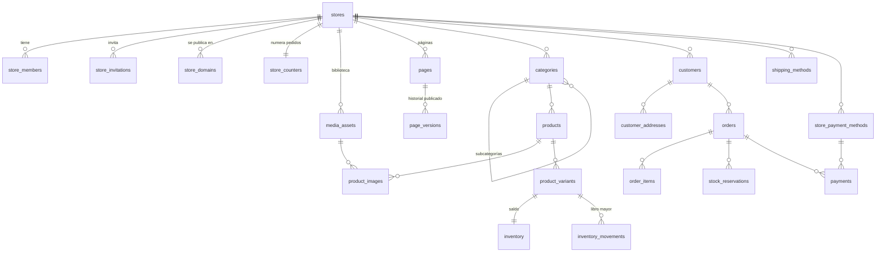

# 02 · Modelo de datos y seguridad

> La fuente de verdad es `supabase/migrations/`. Este documento la explica.
> Validado con 58 escenarios automáticos en `supabase/tests/escenarios/` (todos en verde).

## 1. Diagrama de entidades



Además: `profiles` (1:1 con el usuario), `platform_admins`, `payment_events` (webhooks),
`audit_log` y `notifications`.

## 2. Garantías de aislamiento (tres capas)

| Capa | Mecanismo | Qué impide |
|---|---|---|
| 1. Permisos | `GRANT` por tabla y por columna | Que el navegador toque tablas o columnas que no le corresponden (ej. totales de pedidos, stock, credenciales de pago) |
| 2. Filas | RLS con `is_store_member(store_id)` | Que un usuario vea o modifique filas de otra tienda |
| 3. Estructura | FK compuestas `(store_id, id)` | Que un registro apunte a datos de otra tienda, aunque el código tenga un error |

Y por defecto, lo nuevo **no** queda expuesto: `alter default privileges` quita permisos
a tablas y funciones futuras hasta que una migración los otorgue explícitamente.

## 3. Quién accede a qué

| Actor | Rol de Postgres | Accede a |
|---|---|---|
| Visitante de una tienda | `anon` | Solo vistas del esquema `storefront` (datos publicados) y `get_order_for_buyer` con token |
| Dueño / empleado | `authenticated` | Tablas de `public` de sus tiendas, según RLS y permisos por columna |
| Comprador con cuenta | `authenticated` | Sus propios clientes, direcciones, pedidos e ítems |
| Servidor (Server Actions con privilegio, Edge Functions, webhooks) | `service_role` | Todo. Nunca en el navegador |

### Diferencias dueño vs. empleado

| Acción | Dueño | Empleado |
|---|---|---|
| Productos, stock, páginas, pedidos, clientes | ✅ | ✅ |
| Publicar páginas | ✅ | ✅ |
| Configuración de la tienda, publicar la tienda | ✅ | ❌ |
| Invitar / quitar miembros, cambiar roles | ✅ | ❌ (puede salir él mismo) |
| Ver auditoría | ✅ | ❌ |

## 4. Esquema `storefront` (público)

Vistas de solo lectura con `security_barrier`, que exponen únicamente tiendas
`published` y columnas públicas:

| Vista | Contenido | Nunca expone |
|---|---|---|
| `stores` | Nombre, país, moneda, idioma, tema publicado, contacto | Tema borrador, onboarding |
| `domains` | Hostname → tienda (subdominios y dominios verificados) | Dominios sin verificar |
| `pages` | Páginas con los bloques de la **versión publicada** | Borradores |
| `media` | Imágenes del bucket público | Comprobantes de pago |
| `categories` | Categorías visibles | Ocultas |
| `products`, `product_images` | Productos activos | Borradores y archivados |
| `variants` | Precio, opciones, disponibilidad calculada en el momento | Costo, configuración interna |
| `shipping_methods` | Envíos activos | Inactivos |
| `payment_methods` | Métodos habilitados (Mercado Pago solo si está conectado) | `secret_id`, cuenta conectada |

> **Configuración necesaria en Supabase:** agregar `storefront` a "Exposed schemas" de la API.

## 5. Funciones de negocio

Errores de negocio con códigos estables (la app los traduce a mensajes amables, ver §7).

| Función | Quién | Qué hace |
|---|---|---|
| `create_store(name, slug, country, currency, locale?, tz?)` | authenticated | Crea tienda + dueño + contador + página de inicio. Máx. 5 por persona |
| `check_store_slug(slug)` | authenticated | `disponible` / `en_uso` / `invalida`. No revela datos de otras tiendas. Incluye direcciones reservadas (admin, api, www…) |
| `publish_store(store_id)` | dueño | Publica tema y tienda. Requiere inicio publicado |
| `accept_store_invitation(token)` | authenticated | Suma al usuario si el email coincide y no venció |
| `publish_page(page_id, note?)` | miembro | Congela el borrador como nueva versión y la publica |
| `restore_page_version(page_id, version_id)` | miembro | Trae una versión anterior al borrador |
| `adjust_stock(variant_id, delta, reason, note?)` | miembro | Reponer / corregir / devolución. Nunca por debajo de lo reservado |
| `reserve_stock(order_id, ttl?)` | servidor | Reserva todo el pedido o nada. Bloqueo en orden fijo (sin deadlocks ni sobreventa) |
| `commit_reservation(order_id)` | servidor | Reserva → venta. Registra movimiento. Avisa stock bajo |
| `release_reservation(order_id)` | servidor | Libera reservas activas. Idempotente |
| `release_expired_reservations()` | cron | Libera vencidas y cancela impagos (respeta pagos en revisión) |
| `next_order_number(store_id)` | servidor | Número correlativo por tienda (desde 1001) |
| `apply_payment_status(payment_id, status, provider_id?, raw?)` | servidor | Único punto que aplica efectos de un pago (stock + pedido + avisos) |
| `confirm_manual_payment(payment_id, approve)` | miembro | Aprueba o rechaza un pago manual |
| `get_order_for_buyer(order_id, token)` | anon | Estado del pedido para compradores sin cuenta |
| `create_platform_invitation(...)` / `renew_` / `revoke_` | admin plataforma | Invita a una persona: permiso para crear tiendas (con cupo) y/o sumarla a una tienda con un rol |
| `check_platform_invitation(token)` | anon | Para el registro: email de una invitación vigente |
| `accept_platform_invitation(token)` | authenticated | Aplica permisos y membresía; si un admin creó la tienda para la persona, el admin deja de figurar como dueño |
| `set_person_permissions(user, can_create, max, status)` | admin plataforma | Permisos, cupo y pausa de una persona (una persona pausada pierde acceso a las tiendas) |
| `set_store_suspended(store, bool)` | admin plataforma | Suspende o reactiva una tienda |
| `touch_work_session(store?)` | authenticated | Presencia: extiende la sesión de trabajo (15 min de inactividad abren una nueva) |
| `platform_overview/stores/people/presence/activity/work_hours` | admin plataforma | Lecturas de la consola |
| `preview_storefront_rows(store, vista)` | miembro de la tienda | Vista previa: filas de stores/categories/products/product_images/variants aunque la tienda no esté publicada (`VISTA_INVALIDA` si la vista no existe) |

Triggers: perfil automático al registrarse, inventario automático por variante,
`updated_at`, protección del último dueño, validación de transiciones de pedido.

### Ciclo de vida del pedido

```
pending_payment ──▶ paid ──▶ preparing ──▶ shipped ──▶ delivered
      │               │          │  └──▶ ready_for_pickup ──▶ delivered
      ▼               ▼          ▼
  cancelled       cancelled / refunded (desde cualquier estado pagado)
```

Cualquier otra transición se rechaza con `CAMBIO_DE_ESTADO_INVALIDO`. Cada cambio queda en `audit_log`.

### Ciclo del stock

```
disponible = on_hand − reserved

checkout ─▶ reserve_stock ─▶ reserved += q
pago OK  ─▶ commit_reservation ─▶ on_hand −= q, reserved −= q, movimiento 'sale'
vence / se cancela ─▶ release_reservation ─▶ reserved −= q
```

Vencimiento sugerido de reservas: 30 min para Mercado Pago, 48 h para pago manual.

## 6. Convenciones de datos

| Tema | Regla |
|---|---|
| Dinero | `bigint` en unidad mínima (centavos). La moneda es la de la tienda; pedidos y pagos la copian |
| Monedas sin decimales | CLP, JPY, etc.: exponente según ISO 4217, resuelto en `packages/core/money` |
| Snapshots | Los ítems del pedido copian nombre, variante, SKU y precio al comprar |
| Opciones de variante | `options` jsonb objeto: `{"Color": "Rojo", "Talle": "M"}` |
| Slugs | `^[a-z0-9](-?[a-z0-9])*$` |
| Archivos | Ruta `<store_id>/...`, validado por CHECK y por políticas de Storage |
| Secretos | Solo `secret_id` (referencia a Supabase Vault) |
| Tokens | Se guarda solo el hash sha256 (invitaciones, acceso a pedidos) |

## 7. Códigos de error de negocio

| Código | Mensaje sugerido para la persona |
|---|---|
| `SIN_SESION` | Tu sesión terminó. Volvé a ingresar. |
| `SIN_PERMISO` | No tenés permiso para hacer esto. Pedile acceso al dueño de la tienda. |
| `DIRECCION_EN_USO` | Esa dirección ya la usa otra tienda. Probá con otra. |
| `LIMITE_DE_TIENDAS` | Llegaste al máximo de tiendas. Escribinos si necesitás más. |
| `FALTA_PUBLICAR_INICIO` | Antes de abrir tu tienda, publicá la página de inicio. |
| `TIENDA_SUSPENDIDA` | Tu tienda está pausada. Escribinos para reactivarla. |
| `ULTIMO_DUENO` | La tienda necesita al menos un dueño. Nombrá a otra persona antes. |
| `INVITACION_INVALIDA` | Esta invitación ya no es válida. Pedí una nueva. |
| `INVITACION_OTRO_EMAIL` | Esta invitación es para otro email. Ingresá con el email invitado. |
| `PAGINA_NO_EXISTE` / `VERSION_NO_EXISTE` | No encontramos esa página. Actualizá e intentá de nuevo. |
| `STOCK_INSUFICIENTE` | Alguien se llevó las últimas unidades. Ajustá la cantidad. |
| `STOCK_MENOR_A_RESERVADO` | No podés dejar menos stock del que ya está reservado en pedidos. |
| `MOTIVO_INVALIDO` / `CANTIDAD_INVALIDA` | Revisá la cantidad que ingresaste. |
| `CAMBIO_DE_ESTADO_INVALIDO` | Ese cambio de estado no es posible para este pedido. |
| `PAGO_NO_EXISTE` / `PAGO_YA_RESUELTO` | Este pago ya fue revisado. |
| `SOLO_PAGOS_MANUALES` | Este pago se confirma automáticamente. |
| `PEDIDO_NO_ENCONTRADO` | No encontramos tu pedido. Revisá el link del mail. |
| `SIN_PERMISO_PARA_CREAR` | Todavía no podés crear tiendas. Pedile a quien administra la plataforma que te habilite. |
| `NO_PODES_PAUSARTE` | No podés pausar tu propio acceso. |

## 8. Pendientes de diseño (no bloquean Etapa 1)

- Cupones y descuentos (`discount_amount` ya existe en pedidos).
- Multi-idioma del contenido de una tienda (Etapa 5).
- Comisión de plataforma en Mercado Pago (campo y flujo preparados en el adaptador, desactivados).
- Política de borrado de cuenta de usuario dueño único (hoy `ULTIMO_DUENO` lo bloquea; requiere transferencia).
